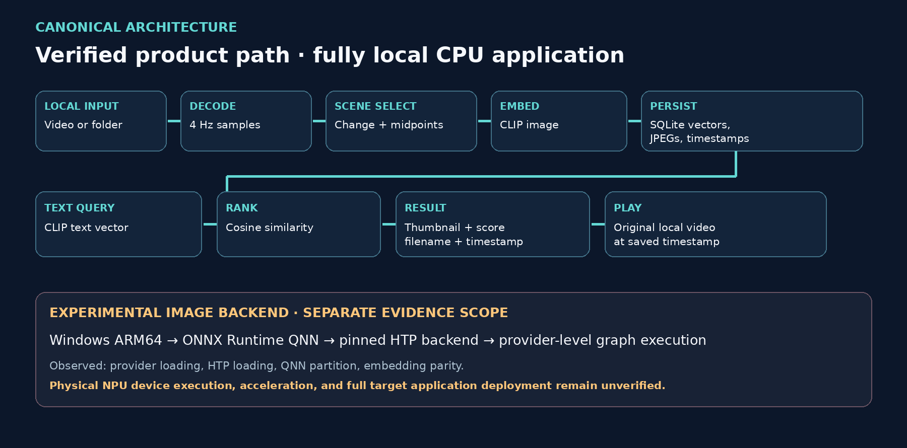

# ClipTrail

**Private, scene-aware search for local video**

Describe a scene. Jump to the moment. Keep every video local.

ClipTrail shows ranked moments with thumbnails, filenames, timestamps, and scores, then opens the source video at the selected moment. Indexing, persistence, retrieval, and playback stay on the local computer.

> **Evidence boundary:** the working application is verified with CPU CLIP. A fixed image graph completed native ARM64 ONNX Runtime QNN execution on a Snapdragon system with the HTP backend loaded, QNN partitioning, and output parity. Direct physical NPU execution was not verified. This project makes no NPU speedup, energy, HP-device deployment, or target application performance claim.

## What ClipTrail does

- Indexes one video or a folder of videos with visible progress.
- Samples video at 4 Hz and keeps representative scene midpoints.
- Stores normalized CLIP image embeddings, thumbnails, and timestamps in SQLite.
- Keeps the model loaded in the persistent application for fast repeat searches.
- Returns ranked moments for natural-language queries.
- Plays the original video around the selected timestamp.
- Keeps source media, embeddings, queries, and results local.
- Supports a verified CPU backend and an isolated experimental Windows ARM64/QNN image backend.

## Demo flow

```text
Select video/folder → index scenes → persist locally → describe a moment
                    → rank saved vectors → inspect thumbnail → play timestamp
```

The browser interface is intentionally small and runs on loopback. There are no accounts, cloud services, analytics, RAG components, or LLMs.

## Quick start

The reference environment uses Python 3.12 and [`uv`](https://docs.astral.sh/uv/). Provisioning downloads the pinned CPU dependencies, CLIP assets, and public reference videos; it does not run a benchmark or target workload.

```bash
bash experiments/cliptrail/provision_reference.sh
.venv-cliptrail/bin/python -m cliptrail_app serve
```

Open `http://127.0.0.1:8765/` if the browser does not open automatically. The default index is `.cliptrail/index.sqlite3`.

Useful alternatives:

```bash
# Start without launching a browser, or choose another persistent index.
.venv-cliptrail/bin/python -m cliptrail_app serve --no-browser
.venv-cliptrail/bin/python -m cliptrail_app --db /path/to/index.sqlite3 serve

# Use the same pipeline from the CLI.
.venv-cliptrail/bin/python -m cliptrail_app index /path/to/video-or-folder
.venv-cliptrail/bin/python -m cliptrail_app search "a cyclist crossing a bridge"
.venv-cliptrail/bin/python -m cliptrail_app open RESULT_ID
.venv-cliptrail/bin/python -m cliptrail_app status
```

Supported discovery extensions are `.mp4`, `.mov`, `.mkv`, `.m4v`, `.avi`, and `.webm`. Browser codec support varies; **Open in local player** uses `mpv`, `ffplay`, or `vlc` when available.

See the [application guide](cliptrail_app/README.md) for CLI options, storage behavior, and playback limits.

## How it works

ClipTrail samples presentation timestamps, computes a low-resolution visual-change signal, forms scene spans, and embeds their midpoint frames with CLIP. Full videos are processed in fixed 60-second windows with at most 16 stored scene frames per window. Queries encode text once and rank the saved normalized image vectors by cosine similarity.

The index records source hashes and model, sampler, and backend identities. Unchanged videos can be reused, incompatible backend rows cannot mix, and a changed video's previous index remains available until replacement commits successfully.

Read the [architecture guide and canonical diagram](docs/architecture.md) for the full data flow and module boundaries.



## Measured results

### Frozen retrieval quality

OpenAI CLIP ViT-B/16, CPU float32, equal 16-frame budgets:

| Selector | Recall@1 | Recall@3 | Short-event Recall@3 |
| --- | ---: | ---: | ---: |
| Uniform | 70.83% | 79.17% | 54.55% |
| Raster change | 70.83% | 75.00% | 72.73% |
| **Scene midpoint used by ClipTrail** | **83.33%** | **87.50%** | **81.82%** |

This benchmark contains **24 positive queries, including 11 short-event queries, across six windows from two public films**. It does not establish accuracy for arbitrary personal videos, whole libraries, or absence queries.

### Persistent application

Recorded on an AMD Ryzen 5 5600H WSL2/Linux CPU host with one loaded model and three video files totaling 2.279 minutes:

| Metric | Result |
| --- | ---: |
| Selected scene frames | 48 |
| Indexing after model load | 15.49 s total; 6.80 s/video minute |
| Warm query latency | 27.45 ms median; 34.70 ms max; n=5 |
| Logical vectors + thumbnails | 570,215 bytes; 250,186 bytes/video minute |
| Closed SQLite file | 638,976 bytes |
| RSS after indexing / after queries | 757.6 MB / 913.6 MB |

These are single-host CPU diagnostics. Storage excludes source media and browser-upload copies. The [complete evidence summary](docs/evidence.md) gives methods, raw-artifact links, memory context, restart checks, and limitations.

## Snapdragon/QNN status

The optional backend preserves the application interface while replacing CPU image embedding with the extracted CLIP image graph under ONNX Runtime QNN. It keeps the text tower on CPU and disables both application-controlled fallback paths.

One fixed-graph smoke on an **ASUS Snapdragon X2 Elite** established:

- native ARM64 Python and ONNX Runtime execution;
- QNN provider registration and loading;
- pinned HTP backend library loading;
- one QNN partition with all 423 transformed nodes reported supported;
- one completed QNN execution-provider kernel; and
- embedding parity against the frozen CPU reference: cosine **0.999982834**.

The hardware profiler did not emit a positive device event or attributable HTP cycles. The process exited with `C0000005` after evidence persistence, with unknown root cause. The QNN path is therefore experimental. It does not support claims of verified physical NPU execution, speedup, energy savings, production stability, full application deployment, or HP-device compatibility.

## Tests

```bash
PYTHONDONTWRITEBYTECODE=1 \
  .venv-cliptrail/bin/python -m unittest discover \
  -s cliptrail_app/tests -p 'test_*.py' -v
```

The six application tests cover deterministic scene selection, vector dimensions, stable ranking, timestamp mapping, transactional replacement, folder indexing, persistence across restart, local HTTP upload, active progress, thumbnails, byte-range video delivery, and playback routing. An offline replay also reproduces the frozen scene result: 20/24 Recall@1, 21/24 Recall@3, and 9/11 short-event Recall@3 without rerunning model inference.

Benchmark reproduction instructions are in [`experiments/cliptrail/README.md`](experiments/cliptrail/README.md).

## Repository map

| Path | Purpose |
| --- | --- |
| [`cliptrail_app/`](cliptrail_app/) | Working local application, browser assets, CLI, persistence, retrieval, and tests |
| [`docs/architecture.md`](docs/architecture.md) | Canonical product architecture and diagram |
| [`docs/evidence.md`](docs/evidence.md) | Benchmark, application, and target evidence with claim boundaries |
| [`docs/positioning.md`](docs/positioning.md) | Final product position, title candidates, and approved claim language |
| [`THIRD_PARTY_NOTICES.md`](THIRD_PARTY_NOTICES.md) | Model, dependency, media, and QNN attribution boundaries |
| [`experiments/cliptrail/`](experiments/cliptrail/) | Frozen retrieval benchmark, manifests, reports, and audit tools |
| [`experiments/cliptrail_app/`](experiments/cliptrail_app/) | Saved application measurements and restart/HTTP validation |
| [`experiments/cliptrail_target/v2/review/`](experiments/cliptrail_target/v2/review/) | Returned target evidence and read-only audit |
| [`submission/`](submission/) | Brief, pitch content, demo script, judge Q&A, and final checklist |
| [`final_submission/`](final_submission/) | Exported brief and seven-slide pitch, demo kit, portal values, claim audit, and checksums |

The rejected feasibility branches remain engineering history and are not part of the main product story. Downloaded weights, source media, QNN runtime packages, deployment bundles, caches, virtual environments, and generated databases are intentionally excluded from the public tree.

## Evidence and attribution

ClipTrail uses the public OpenAI CLIP ViT-B/16 checkpoint through Transformers/PyTorch. Source-film assets and Qualcomm/ONNX Runtime components retain their upstream terms. The repository records model revision, artifact hashes, dependency versions, and relevant [third-party notices](THIRD_PARTY_NOTICES.md) alongside the experiment or target material. Large third-party binaries are downloaded locally and are not intended for publication.

Original ClipTrail code is released under the [MIT License](LICENSE). The [third-party notices](THIRD_PARTY_NOTICES.md) remain separate. See the [public-repository audit](docs/public-repository-audit.md) before publishing.
