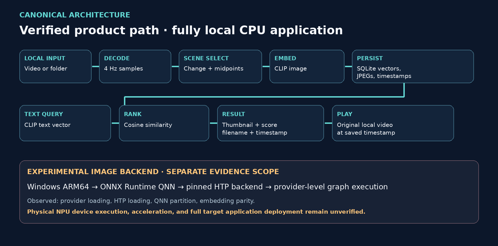
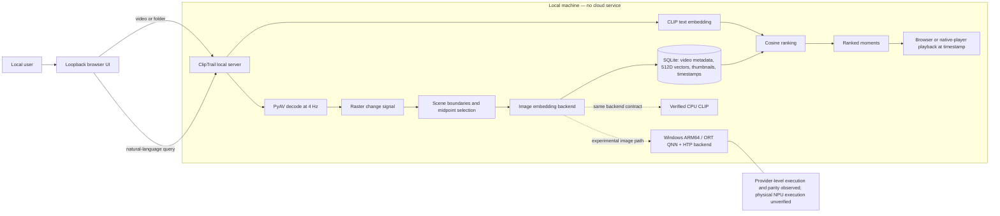

# ClipTrail architecture

ClipTrail is a local, persistent semantic video search application. One process owns the embedding backend for its lifetime, while the browser interface, SQLite index, source media, thumbnails, and playback stay on the same computer.

## Canonical architecture diagram

The rendered diagram above is the presentation version of the canonical flow below.

## Indexing path

1. The application discovers one video or recursively discovers supported videos in a folder.
2. PyAV samples presentation timestamps at 4 Hz. A 96×54 RGB change signal records visual transitions without retaining every decoded full-resolution frame.
3. The frozen scene selector enforces a three-sample cut separation, creates scene spans, and chooses their midpoint frames. Full videos are divided into fixed 60-second windows with at most 16 selected frames per window.
4. The active backend creates normalized 512-dimensional image embeddings. The application saves embeddings, JPEG thumbnails, source timestamps, source hash, backend identity, and sampler identity in SQLite.
5. Replacement is transactional: a changed video's old index remains usable until the new index commits successfully.

The 60-second window rule extends the frozen benchmark's preselected 40–60 second windows. Retrieval quality measured on the frozen corpus cannot be transferred to arbitrary full videos or libraries.

## Query and playback path

The persistent process keeps its CLIP backend loaded. Each query creates one text embedding, reads compatible image vectors from SQLite, computes cosine similarity, and returns a stable ranking. Result cards show the thumbnail, filename, timestamp, and score. Selecting a card streams the source video over loopback with HTTP byte ranges and seeks to the stored timestamp; a native-player action handles formats the browser cannot decode.

## Module boundaries

| Module | Responsibility |
| --- | --- |
| `cliptrail_app/video.py` | Video discovery, 4 Hz decode, change measurements, selected-frame extraction, and presentation timestamps |
| `cliptrail_app/backends.py` | Shared embedding protocol, verified CPU implementation, and experimental QNN image implementation |
| `cliptrail_app/indexer.py` | Hashing, two-pass indexing, progress events, embedding validation, and transactional writes |
| `cliptrail_app/store.py` | SQLite schema, backend isolation, video/frame persistence, and stored metrics |
| `cliptrail_app/search.py` | Text encoding, vector validation, cosine ranking, and result projection |
| `cliptrail_app/playback.py` | Stored-result resolution and safe local-player invocation |
| `cliptrail_app/web.py` | Loopback API, lifetime backend, background indexing, serialized inference, local media delivery, and status |
| `cliptrail_app/web_assets/` | Minimal video selection, progress, library, search, results, and playback interface |
| `cliptrail_app/cli.py` | Scriptable index, search, status, metrics, playback, and server commands |

## Backend evidence boundary

CPU CLIP via PyTorch/Transformers is the verified application backend. The optional QNN adapter uses the extracted CLIP image graph with both fallback controls disabled and uses the CPU CLIP text tower. CPU and QNN rows have different backend identities and cannot mix in one ranking.

On an ASUS Snapdragon X2 Elite target, the fixed image graph completed native ARM64 ONNX Runtime QNN inference with the pinned HTP backend loaded, one QNN partition, and output matching the CPU reference. Hardware profiling did not emit the required device events. The evidence establishes provider-level execution and compatibility, not verified physical NPU execution, acceleration, power savings, production stability, or application deployment on target.

## Privacy and reliability properties

- The server binds only to `127.0.0.1` and uses a random process-local token for API and media requests.
- No account, analytics service, cloud API, remote database, RAG component, or LLM is used.
- Search never re-embeds video frames from a valid prebuilt index.
- Source SHA-256, sampler identity, and backend identity control cache reuse.
- Nonfinite or incorrectly shaped embeddings are rejected.
- Indexing and searching share an inference lock; status and media requests remain responsive.
- Individual folder failures are reported without discarding successful videos.
- Browser playback depends on local codec support; native-player fallback is available.
